# Rover Image Scraper

Downloads the raw photos taken by NASA's four Mars rovers (**Curiosity**, **Perseverance**, **Spirit** and
**Opportunity**) into a tidy folder on your computer. Run it again later and it fetches only what's new or still
missing, so it can keep a growing collection up to date. Its **Photos** page browses what you've downloaded, with
when and where each photo was taken.


It's free and open source (see [License](#license)).

- **Curiosity and Perseverance** (both still exploring Mars) come from the free
  [Mars Vista API](https://github.com/james-langridge/mars-vista-api), which lists every raw photo NASA has
  published for them and needs a free API key. The photos themselves download straight from NASA's image servers.
- **Spirit and Opportunity** (missions ended in 2010 and 2018) come from NASA's
  [Planetary Data System (PDS) Imaging Node](https://pds-imaging.jpl.nasa.gov/), NASA's permanent archive of
  mission data. No key is needed.

A *sol* is a day on Mars, counted from the day the rover landed. Photos are organised by rover, sol and camera.

## Download and run

Get the app from the [latest release](https://github.com/cincottash/RoverImageScraper/releases/latest). It needs
no Python and installs nothing.

- **Windows:** download **RoverImageScraper.exe** and double-click it. If Windows shows *"Windows protected your
  PC"* (the program isn't code-signed), click *More info*, then *Run anyway*.
- **Linux:** download **RoverImageScraper-x86_64.AppImage**, then `chmod +x RoverImageScraper-x86_64.AppImage`
  and run it (or tick *Allow executing file as program* in its *Properties* and double-click it).
- **macOS:** run it from the source code (see *Running from the source code* below).

## First run

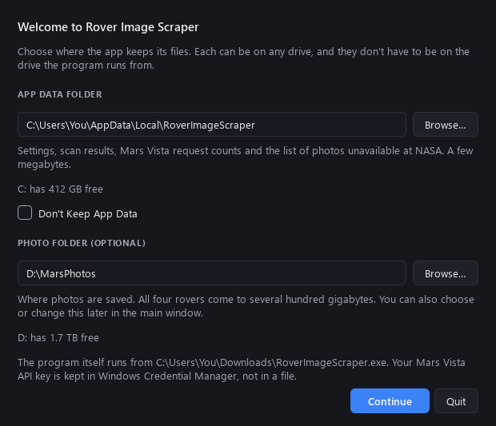

The app asks where to keep its own small files (the *app data folder*: settings, scan results and request counts)
and, optionally, where to save photos. Each can be on any drive.

Then get a free Mars Vista API key at [marsvista.dev](https://marsvista.dev) and paste it into *API Key*. The app
keeps it in your system's credential store (Windows Credential Manager, the macOS Keychain or your Linux keyring),
not in a file. Keep it private: anyone with it can use your Mars Vista quota.

<br clear="right">

## Using it

1. Choose a **photo folder** and paste your **API key**.
2. Tick the **rovers** you want.
3. Click **Quick Scan** to see what's in the folder and what's online.
4. Optionally click **Preview** for an estimate.
5. Click **Start**. If Start is greyed out, the line beside it says what's missing.

### Rovers and cameras

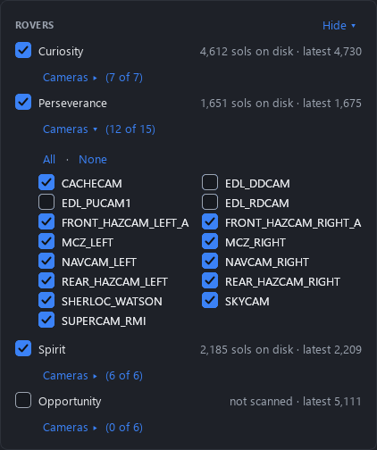

Tick a rover to include it. *Cameras* opens its list of cameras, so you can leave out the ones you don't want.
Unticking a rover unticks its cameras; ticking it again brings back the cameras you had.

<br clear="right">

### Options

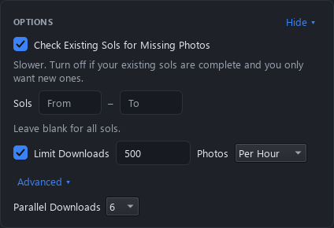

- **Check Existing Sols for Missing Photos:** also fill in gaps in sols you already have (slower). Untick it to
  download only sols newer than your newest.
- **Sols:** a range of sols. Leave both boxes blank for all.
- **Limit Downloads:** at most this many photos per minute, hour or day. When the limit is reached, the download
  waits and carries on by itself.
- **Advanced > Parallel Downloads:** photos downloaded at once (1–16, default 6).

<br clear="right">

### Library status

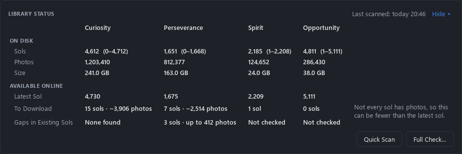

What's in your folder and what's online, for every rover, ticked or not. *Quick Scan* counts both for the ticked
rovers; the others keep the numbers from their last scan. *Full Check* also finds gaps inside the sols you have; it
uses about one Mars Vista request per sol, so it asks first.

### Progress and API usage

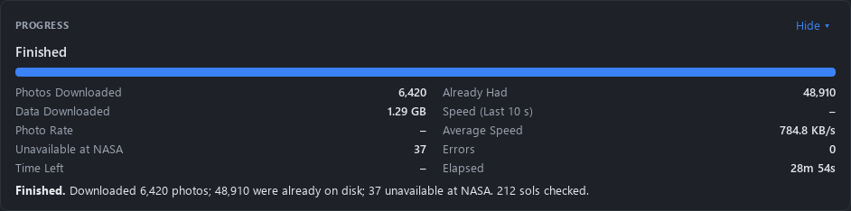

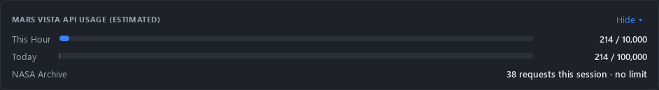

*Latest Photo* shows the newest photo saved; *Show on Photos Page* opens it there.

*Unavailable at NASA* counts photos NASA's servers won't send; they're remembered and skipped on later runs.
Mars Vista allows 10,000 requests an hour and 100,000 a day. Near a limit, an amber banner shows when the run
resumes, and it carries on by itself.

### Preview

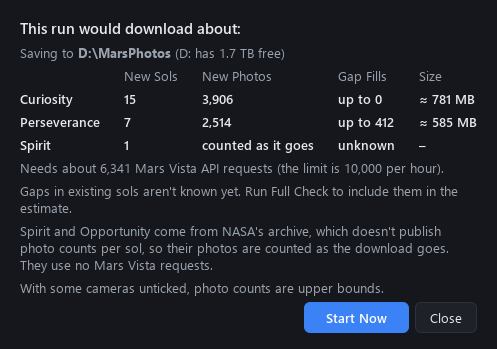

**Preview** estimates what a download would add, where it goes, the free space there, and how many Mars Vista
requests it needs, without downloading anything. *Start Now* starts it.

<br clear="right">

### Pause, Stop and changing settings

- **Pause** finishes the photos in progress and remembers where it was. **Resume** carries on from that sol.
- **Stop** (or closing the app) ends the run. Finished photos are always kept.
- **During a download**, *Parallel Downloads* and *Limit Downloads* can change and apply at once. Rovers,
  cameras and the sol range are locked until the run ends.

Every card can fold to its title bar with its *Hide* link (*Show* opens it again), and the app remembers which
are folded.

## Photos


The **Photos** tab (or *Ctrl+2*) browses the photo folder without a file manager.

- **Browse:** choose a rover, then a sol (with its number of photos), then a camera, or type a sol into *Go To
  Sol* (it opens that sol, or the nearest one). While a download runs, *Newest Downloads* lists the photos as they
  arrive. *Favorites* and *Flipbooks* are at the top (below).
- **Thumbnails:** *Thumbnail Size* makes them bigger or smaller. Arrow keys move between photos.
- **Details:** the chosen photo's preview, rover, sol, camera, size and file, and the details looked up online
  (below). *Show in Folder* opens it in your file manager.
- **Full size:** *View Full Size*, a click on the preview, or a double-click on a thumbnail. The mouse wheel zooms,
  dragging moves the photo, and a double-click switches between *Fit* and *Actual Size*. *Previous* and *Next*
  (or the arrow keys) step through the camera's photos; *Esc* goes back.

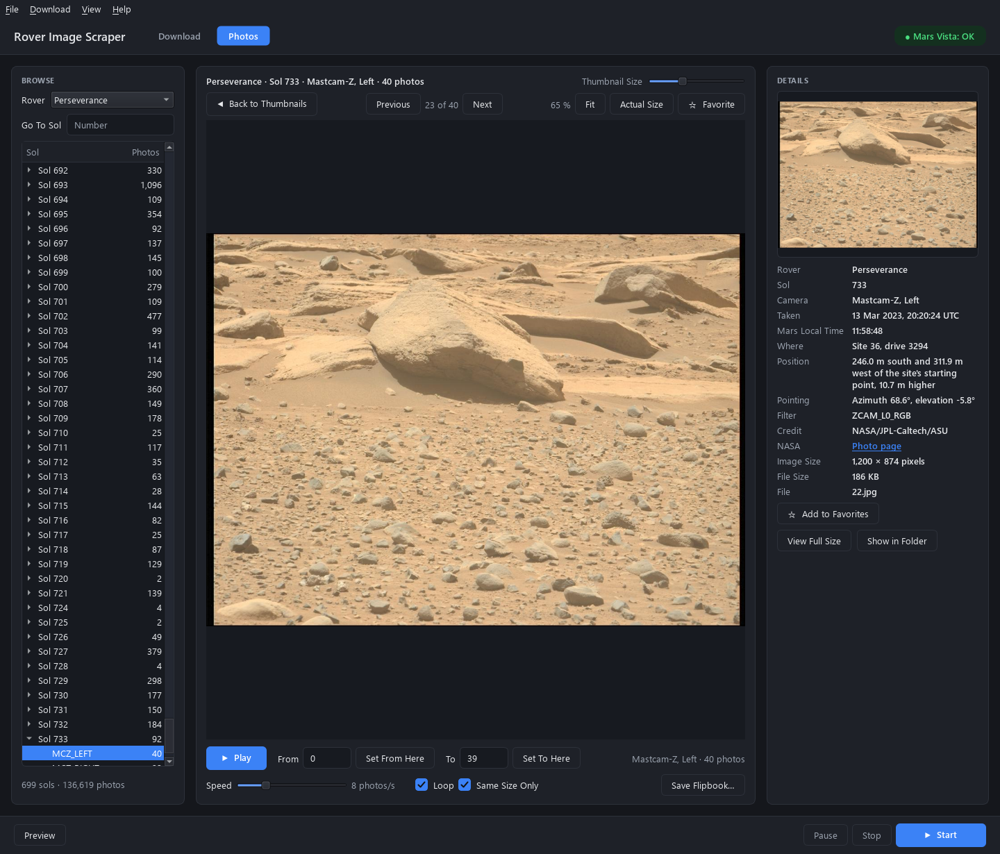

**When and where each photo was taken** is looked up online the first time you open a sol, for all its photos at
once, and kept in the app data folder, so it shows instantly after that (also offline). It shows the time taken
(UTC) and on Mars, the site and drive (the rover's place along its route), the position from the site's starting
point, where the camera pointed, the filter, and a link to the photo's NASA page. Curiosity and Perseverance use a
few Mars Vista requests per sol (an API key is needed); Spirit and Opportunity use NASA's archive.

*Download > Get Details for Downloaded Photos…* looks up every sol in the folder ahead of time. It can be stopped
at any point; the next run carries on from there.

<details>
<summary><b>How photos are matched to their details</b></summary>

- Photos downloaded by this version are recorded as they're saved, so their details need no matching.
- Photos already in the folder are matched to NASA's list by their exact file size, never by their order. Photos
  that match no single NASA photo (for example old thumbnails, or copies from NASA's former image gallery) show
  details for the sol as a whole, and say so.
- Downloading more photos into a sol looks it up again the next time it's opened.
- The details belong to the photo folder: after moving the folder, sols are looked up again.

</details>

### Favorites

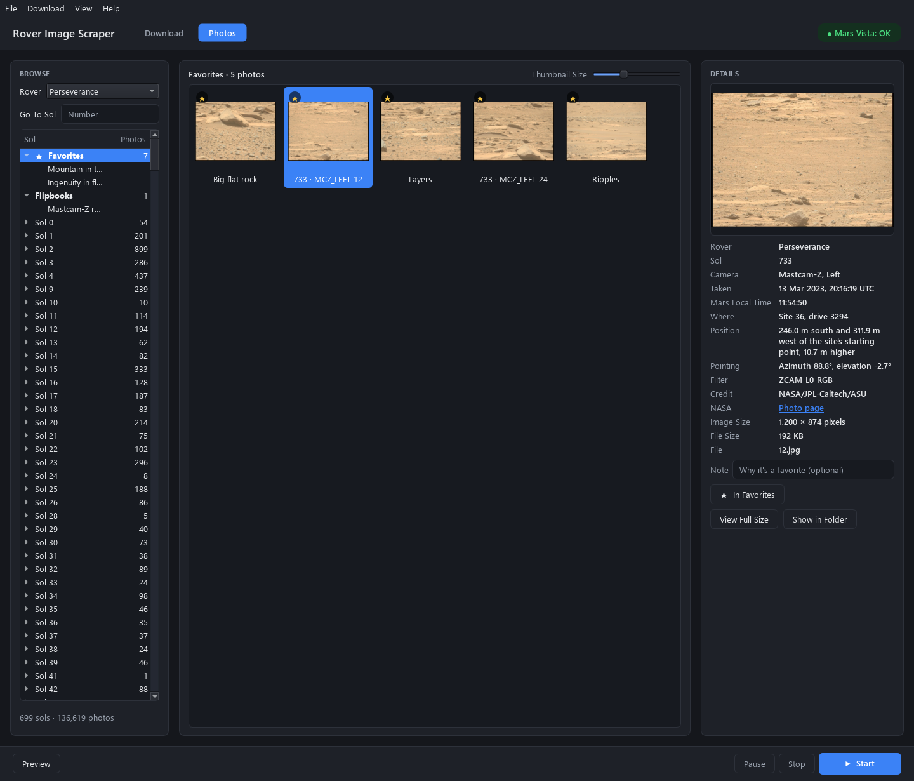

- **A photo:** *Add to Favorites* in the details, *Favorite* at full size, or the **F** key. Favorites get a star
  on their thumbnail and a *Note* box in the details; the note becomes the thumbnail's caption under *Favorites*.
- **A sol or camera folder:** right-click it in the list. Favorite folders are listed under *Favorites*; choosing
  one goes there. Right-click one to edit its note or remove it.
- **Favorites** at the top of the list shows the favorite photos of every rover.
- *File > Import Favorites…* adds favorites from a text list with one `Rover/sol/CAMERA/number` per line (the
  number, or the camera and number, can be left out for a whole folder), then an optional note. It shows what it
  will add, and which lines it didn't understand, before adding anything.

Favorites are kept in the app data folder by rover, sol, camera and number, so they still apply after the photo
folder moves.

### Flipbooks

Photos taken a moment apart play like a film: a landing, the arm moving, the sky changing. At full size:

1. Choose **From** and **To** (they start as the camera folder's first and last photo), or use *Set From Here* and
   *Set To Here* on the photo shown.
2. Click **Play** (or press **P**). **Speed** is 1–30 photos a second; **Loop** starts again after the last photo.
   **Same Size Only** skips photos of another size than the first, as folders often mix full frames with
   thumbnails. Photos play in the order they were taken when that's known, otherwise in their numbers' order.
3. **Save Flipbook…** keeps it, with its name, photos, speed and options, under *Flipbooks* in the list. Choosing
   it plays it again; change the speed or anything else, then *Save Changes* (or *Save as New…*). Right-click a
   saved flipbook to rename or delete it.

Frames are read a little ahead of the one shown; on a slow disk the flipbook pauses rather than skipping photos.

## Menus

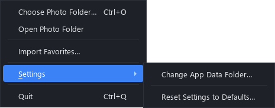 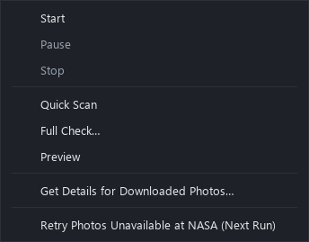

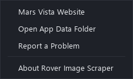

### Themes

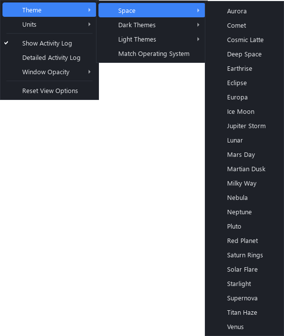 Theme: the Space, Dark Themes and Light Themes groups, then Match Operating System, with the Space themes open">

*View > Theme* has 61 themes in three groups (**Space**, made for this app; **Dark Themes**; **Light Themes**),
then **Match Operating System**. The app starts in *Dark*.

Point at a theme to see it on the window; click to keep it. Closing the menu without clicking goes back to the
theme you had.

<br clear="right">

### Window opacity

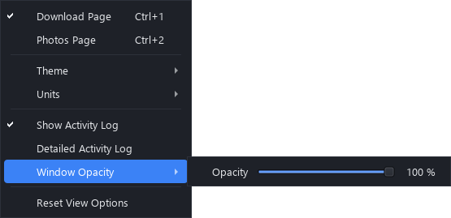

*View > Window Opacity* makes the whole app see-through: the window, its menus and dropdown lists, dialogs and
tooltips. Everything changes as the slider moves (30–100 %). While it's below 100 %, *Browse…* opens the app's own
folder picker instead of the system's, because the system's can't be see-through.

<details>
<summary><b>Every menu item</b></summary>

- **File:** Choose Photo Folder… (Ctrl+O), Open Photo Folder, Import Favorites… (see [Favorites](#favorites)),
  **Settings** (Change App Data Folder…, Reset Settings to Defaults…), Quit (Ctrl+Q).
- **Download:** Start, Pause, Stop, Quick Scan, Full Check… and Preview (the same as the buttons), *Get Details
  for Downloaded Photos…* (see [Photos](#photos)), and *Retry Photos Unavailable at NASA (Next Run)*, which tries
  all photos NASA wouldn't send again on the next run.
- **View:** Download Page (Ctrl+1), Photos Page (Ctrl+2), Theme, **Units** (Data: Auto, KB, MB, GB or TB; Speed: Auto, KB/s, MB/s or Mbit/s; Speed Averaged
  Over: 5, 10, 30 or 60 seconds), Show Activity Log, Detailed Activity Log (a line for every sol checked and
  every photo saved or skipped), Window Opacity, Reset View Options.
- **Help:** Mars Vista Website, Open App Data Folder, Report a Problem (the project's GitHub issues), About.

*Reset Settings to Defaults* resets rovers, cameras, the sol range, parallel downloads, the download limit and
the retry option. The photo folder, the API key, the app data folder, scan results and request counts are kept.
View options have their own reset.

</details>

<details>
<summary><b>What each number means</b></summary>

- **Library status:** for each rover, what's in your folder (sols, photos, size) and what's available online
  (the latest sol, and the sols and photos you don't have yet). For Spirit and Opportunity the number of photos
  isn't known until each sol is looked at, so only sols are shown. Not every sol has photos (for example during
  solar conjunction, when the Sun blocks communication with Earth), so *To Download* can be fewer than the latest
  sol. If you've downloaded since the last scan, a note says the numbers are out of date until you scan again.
- **Photos Downloaded** and **Data Downloaded:** in this run.
- **Already Had:** photos that were already in your folder (in sols that were already complete, or found while
  filling in a sol).
- **Unavailable at NASA:** photos NASA's image servers won't send (HTTP 403 or 404), usually older images NASA
  no longer serves. They can't be downloaded, so the app remembers them and skips them on later runs instead of
  counting them as missing.
- **Speed**, **Photo Rate** and **Average Speed**, **Errors**, **Elapsed**, and **Time Left:** an estimate based
  on how fast sols went by over the last two minutes. It can change noticeably when the run moves from sols you
  already have (fast) to new ones (slower, since they're downloaded).
- **Mars Vista API Usage:** requests used this hour and today, counted by the app. *NASA Archive* counts requests
  for Spirit and Opportunity, which have no limit.
- **Limit Downloads:** with 500 per hour, no 60-minute stretch has more than 500 photo downloads. Typing a number
  or choosing a period turns the limit on; untick the box to turn it off.
- **Paused, then changed:** if you change rovers, cameras or the sol range while paused, Resume asks whether to
  carry on with the original choices or start a new download with the new ones.

</details>

## Where your photos go

```
<photo folder>/
  Curiosity/
    3786/
      MAST/
        0.jpg
        1.jpg
        ...
      NAVCAM/
        0.jpg
        ...
  Perseverance/
    ...
```

The app never overwrites, renames or deletes files in your photo folder. It only adds new ones.

<details>
<summary><b>How it decides what to download</b></summary>

- The layout is `<photo folder>/<Rover>/<sol>/<CAMERA>/<n>.<type>`. Within each camera folder, photos are
  numbered 0, 1, 2… in the order the source lists them.
- The extension (almost always `.jpg`) comes from the file's own contents, never guessed from its name or web
  address, so your file manager can show previews. Only real photos (JPEG, PNG, GIF or TIFF) are saved: if a
  server sends something else in place of a photo, such as a "502 Bad Gateway" error page, it's tried again a few
  times and then counted as an error and listed under *Show Problems*. It's not saved, so the next run sees the
  photo as missing and downloads it.
- Files named just `<n>`, as older versions saved them, count toward a folder's total too, and the app never
  renames them.
- For each sol it compares the number of photos on disk with the number the source lists, camera by camera.
  Sols that match are skipped quickly. A camera folder with too few photos gets only the ones it's missing,
  numbered after the highest existing file.
- A run that's stopped keeps every finished photo and leaves no half-written files. Start again to continue.
- Mars Vista requests are counted so the app slows down before a limit and waits if the server asks it to. Photo
  downloads and everything for Spirit and Opportunity don't count toward Mars Vista's limits.
- For Spirit and Opportunity, each sol's photos are read from NASA's archive folders: the full-frame,
  downsampled and sub-frame images (thumbnails and calibration images are left out). Sols without photos are
  answered in a fraction of a second.
- Photos NASA won't serve are remembered in the app data folder (`unavailable.json`), so they aren't counted as
  missing on every run.

**Good to know**

- **Spirit and Opportunity folders that came from somewhere else are left as they are.** If a Spirit or
  Opportunity camera folder holds photos that weren't downloaded from NASA's archive (for example copies from
  NASA's public image gallery, which are brightened and a slightly different size), the app can't tell which
  archive photos it already contains. Rather than add copies of photos you have, it leaves such folders alone
  (logged as `KEEP`). Sols and cameras missing entirely are still downloaded, and folders the app started itself
  are completed as usual.
- **Extra files in a folder count as photos.** The app counts every numbered file in a camera folder. If a folder
  contains extra numbered files from another tool (thumbnails, for example), it can look complete even though a
  photo is missing.

</details>

<details>
<summary><b>The app data folder</b></summary>

The app keeps a few files of its own (settings, scan results, Mars Vista request counts, the list of photos
unavailable at NASA, the photo details looked up for the Photos page in `photo_details.db`, and your favorites and
flipbooks in `favorites.json`) in its *app data folder*, never in your photo folder. The photo details grow with your library: roughly 200–250 MB once all of
Curiosity's and Perseverance's photos have theirs. You choose it on first run; it
can be on any drive. The suggested place is `%LOCALAPPDATA%\RoverImageScraper\` on Windows and
`~/.local/share/RoverImageScraper/` on macOS and Linux. Which folder you chose is remembered for your user account
(in the Windows registry under `HKCU\Software\RoverImageScraper`, or in `~/.config/RoverImageScraper/data_folder`
on macOS and Linux), and the command line uses the same folder.

To move it later, use *File > Settings > Change App Data Folder*: the files are copied (the originals are left
where they were) and the app restarts.

To keep nothing between launches, tick *Don't Keep App Data* in that window. Settings, scan results and counters
then live in a temporary folder that's deleted when the app closes, and every launch starts fresh. The
trade-off: request counts restart at zero each time, so the app can't keep you under Mars Vista's limits across
restarts, and photos unavailable at NASA are tried again on each run. Downloaded photos are always kept.

</details>

<details>
<summary><b>Command line</b></summary>

The same downloads can run from a terminal, which is handy for scheduled updates. It runs from the source code:
first follow *Running from the source code* below, which creates the `.venv` folder these commands use. Commands
are run from the project folder; in the examples, replace `C:\path\to\MarsPhotos` with your photo folder (on
macOS or Linux, a path such as `~/MarsPhotos`). The folder must already exist.

```bat
:: First download into an empty folder (everything for all four rovers: well over a million photos and
:: several hundred gigabytes)
.venv\Scripts\python rover_scraper\main.py "C:\path\to\MarsPhotos"

:: Preview what would be downloaded, without writing anything
.venv\Scripts\python rover_scraper\main.py "C:\path\to\MarsPhotos" --dry-run

:: Update a folder that already has photos (adds missing photos only)
.venv\Scripts\python rover_scraper\main.py "C:\path\to\MarsPhotos" --allow-existing

:: Only one rover, only some sols
.venv\Scripts\python rover_scraper\main.py "C:\path\to\MarsPhotos" --allow-existing --rovers perseverance --sol-min 1000 --sol-max 1100
```

On macOS or Linux, use `.venv/bin/python rover_scraper/main.py ...`.

| Option | Meaning |
|---|---|
| `--rovers` | Comma-separated: `curiosity`, `perseverance`, `spirit`, `opportunity` (default: all four) |
| `--sol-min`, `--sol-max` | Sol range to check (default: all sols) |
| `--dry-run` | Show what would be downloaded; write nothing |
| `--allow-existing` | Required to add to a folder that already contains rover photos |
| `--new-only` | Only download sols newer than the newest one in the folder; don't check existing sols for gaps |
| `--cameras` | Comma-separated camera names to include, e.g. `NAVCAM,MAST` (default: all) |
| `--max-files N` | Download at most N photos per period (a rolling window); waits, then continues |
| `--per` | The period for `--max-files`: `minute`, `hour` (default) or `day` |
| `--workers` | Parallel downloads (default 6) |
| `--verbose` | Also list every sol checked and every photo saved or skipped |
| `--report <file>` | Save a JSON summary of the run |
| `--retry-unavailable` | Try again the photos NASA wouldn't send on earlier runs |

The command line uses the key saved by the desktop app. Without the app, set it as an environment variable
instead, then open a new terminal: `setx MARSVISTA_API_KEY your_key_here` on Windows, or
`export MARSVISTA_API_KEY=your_key_here` in your shell profile on macOS and Linux.

</details>

<details>
<summary><b>Running from the source code</b></summary>

Needed for the command line, and on macOS. You need **Python 3.10 or newer**
([python.org](https://www.python.org/downloads/)) and [Git](https://git-scm.com/downloads). Once, set up a private
Python environment in the project's `.venv` folder with the libraries the app needs:

```bat
git clone https://github.com/cincottash/RoverImageScraper
cd RoverImageScraper
py -3 -m venv .venv
.venv\Scripts\pip install -r requirements.txt
```

Then start the desktop app from the project folder with:

```bat
.venv\Scripts\python rover_scraper\gui.py
```

On macOS or Linux, use `python3 -m venv .venv`, `.venv/bin/pip` and `.venv/bin/python`. If `py -3` or `python3`
picks a Python older than 3.10, name the version instead, such as `py -3.12` or `python3.12`.

</details>

<details>
<summary><b>The standalone app, and building it yourself</b></summary>

The desktop app is packaged with [PyInstaller](https://pyinstaller.org) into one file per system, attached to
each [release](https://github.com/cincottash/RoverImageScraper/releases). Each carries its own private copy of
Python and the libraries it needs, so it runs without Python and downloads nothing to start. The standalone app is
the desktop app only; the command line runs from the source code.

- **Windows: `RoverImageScraper.exe`** (about 35 MB). Each time it starts it unpacks itself into Windows'
  temporary folder (about 90 MB); that copy is removed when it closes.
- **Linux: `RoverImageScraper-x86_64.AppImage`** (an [AppImage](https://appimage.org), about 60 MB). Runs on
  64-bit Intel/AMD Linux from about 2022 on: Ubuntu 22.04 or newer, Debian 12, Fedora 36 and similar. If it says
  FUSE is missing, install it (`sudo apt install libfuse2` on Ubuntu/Debian) or run it with
  `--appimage-extract-and-run`. The API key is kept in your desktop's keyring (GNOME Keyring or KWallet); without
  one, the key has to be entered each session.

**Building them yourself.** You need Python 3.10 or newer and a copy of the project (`git clone`, as above). No
other setup is needed: the first build sets up its own Python environment with the libraries and PyInstaller, in
`build-venv` inside the `--out` folder (a minute or two, about 250 MB). Later builds into the same folder reuse it,
and update it when the requirements change. If the Python you run it with already has them installed, it's used
as is.

The Windows `.exe`, on Windows, from the project folder:

```bat
py -3 packaging\build_exe.py --out C:\path\to\builds
```

The Linux AppImage, on 64-bit Linux, from the project folder, with
[appimagetool](https://github.com/AppImage/appimagetool/releases). It runs on distributions at least as new as
the one it's built on:

```sh
python3 packaging/build_appimage.py --out ~/builds --appimagetool /path/to/appimagetool
```

Each build goes into a new dated subfolder of `--out`. The release builds use Python 3.10.

**Automatic builds and releases.** `.github/workflows/build-apps.yml` builds both apps on GitHub (the `.exe` on
Windows, the AppImage on Ubuntu 22.04) and checks that each starts:

- **Pull requests:** builds are kept for 14 days as downloads on the run's page (*Actions* tab), so changes can
  be tried before merging. Nothing is published.
- **Every merge into `main`:** the same, then a release is published with both apps, tagged with the next
  version (v1.3.0 → v1.3.1 → v1.3.2, and so on). For a bigger step, put `[minor]` (v1.4.0) or `[major]` (v2.0.0)
  in the pull request's title (or its commit's title).
- **A version tag pushed by hand** (`git tag v2.0.0` then `git push origin v2.0.0`) publishes exactly that
  version.

</details>

<details>
<summary><b>Code layout</b></summary>

All program code is in `rover_scraper/`:

- `gui.py`: the desktop app. `main.py` and `cli.py`: the command line.
- `api.py`: the Mars Vista client. `pds.py`: NASA's archive, for Spirit and Opportunity.
- `scraper.py`: checks sols and downloads what's missing. `plan.py`: works out what a sol is missing.
- `download.py`: downloads that never overwrite existing files.
- `scan.py`: Library status (quick scan and full check).
- `ratelimit.py`: counts Mars Vista requests, and the optional download limit.
- `photo_page.py`: the Photos page. `photo_library.py`: finds the photos in the folder.
  `photo_details.py`: looks up when and where photos were taken, and keeps the details.
  `favorites.py`: favorites and saved flipbooks. `flipbook.py`: the flipbook player and its controls.
- `state.py`: the app data folder, and the photos NASA won't serve. `settings.py`: the app's saved settings.
- `check.svg` and `check_dark.svg`: the tick drawn in checkboxes (white, or dark on light accent colors).

Packaging: `packaging/build_exe.py` (Windows), `packaging/build_appimage.py` (Linux), `packaging/build_env.py`
(sets up the build's Python environment when needed), `packaging/make_icon.py` and
`packaging/icon.svg` (the app icon), and `packaging/requirements-build.txt` (the build tools, pinned).

</details>

## License

Copyright (C) 2026 cincottash

Rover Image Scraper is free software: you can redistribute it and/or modify it under the terms of the
[GNU General Public License version 3](LICENSE) (GPL-3.0). Anyone may use, copy, modify and share it; if you
distribute a modified version, it must also be released under the GPL-3.0 with its source code.

It uses [PySide6 / Qt](https://www.qt.io/qt-for-python) (LGPL-3.0), [requests](https://requests.readthedocs.io)
(Apache-2.0) and [keyring](https://github.com/jaraco/keyring) (MIT). The photos themselves are NASA's (image
credit: NASA/JPL-Caltech).

Many of the *Dark Themes* and *Light Themes* are based on the colors of these open-source color schemes, by their
authors (adjusted slightly so every theme looks distinct): Nord, Dracula, Solarized, Gruvbox, One Dark / One Light,
Tokyo Night, Catppuccin, Rosé Pine, Everforest, Kanagawa, Ayu, Palenight, Night Owl, Cobalt2, Synthwave '84,
Tomorrow, Monokai and Zenburn.
