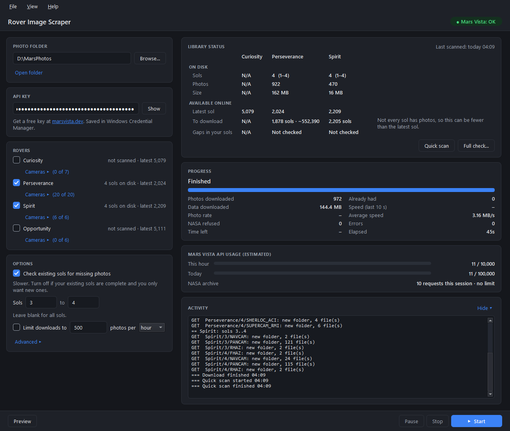

# RoverImageScraper

Downloads raw photos from NASA's Mars rovers (Curiosity, Perseverance, Spirit and Opportunity) into a simple
folder tree. Run it again later and it downloads only what's new or missing.

- **Curiosity and Perseverance** come from the [Mars Vista API](https://github.com/james-langridge/mars-vista-api).
- **Spirit and Opportunity** come straight from NASA's
  [Planetary Data System (PDS) Imaging Node](https://pds-imaging.jpl.nasa.gov/) archive. Mars Vista's lists for
  these two rovers leave out many photos, and the PDS archive is NASA's permanent record of them. No API key or
  Mars Vista requests are needed for them.



```
<dest>/
  Curiosity/
    3786/
      MAST/
        0
        1
        ...
      NAVCAM/
        0
        ...
  Perseverance/
    ...
```

The layout is `<dest>/<Rover>/<sol>/<CAMERA>/<n>`. A *sol* is a Mars day counted from landing, and files are
numbered 0, 1, 2… within each camera folder. Files have no extension, but they are ordinary JPEG images.

## Download

The easiest way to run it is the ready-made app from the
[latest release](https://github.com/cincottash/RoverImageScraper/releases/latest). It needs no Python and installs
nothing. On first run it asks where to keep its files and photos. You'll need a free Mars Vista API key (see step 3
below). More details: [Standalone app](#standalone-app).

- **Windows:** download **RoverImageScraper.exe** and double-click it.
- **Linux:** download **RoverImageScraper-x86_64.AppImage**, make it executable, and run it:
  ```sh
  chmod +x RoverImageScraper-x86_64.AppImage
  ./RoverImageScraper-x86_64.AppImage
  ```
  (Or right-click it, tick *Allow executing file as program* in *Properties*, and double-click.)
- **macOS:** run it from the source code (below).

## Setup (from the source code)

These steps run the program from the source code: needed for the command line, or on macOS.

1. Install **Python 3.10 or newer**.
2. Clone the repo and create a virtual environment:
   ```bat
   git clone https://github.com/cincottash/RoverImageScraper
   cd RoverImageScraper
   py -3.10 -m venv .venv
   .venv\Scripts\pip install -r requirements.txt
   ```
   On macOS or Linux, use `python3 -m venv .venv` and `.venv/bin/pip`.
3. Get a free API key at [marsvista.dev](https://marsvista.dev) (sign-up with an email address).
   - **Desktop app:** paste the key into the API key box. It's saved in the system credential store (Windows
     Credential Manager) and used by the command line too.
   - **Command line only:** you can instead store it in an environment variable, then open a **new** terminal:
     ```bat
     setx MARSVISTA_API_KEY your_key_here
     ```
     On macOS or Linux, use `export MARSVISTA_API_KEY=...` in your shell profile.

   Keep the key out of git.

## Desktop app

From the project folder:

```bat
.venv\Scripts\python rover_scraper\gui.py
```

1. Choose a **photo folder** (any drive) and paste your **API key**. If the folder doesn't exist yet, the app
   offers to create it when you start, scan or open it.
2. Click **Quick scan** to see what's already in the folder and what's new on Mars Vista.
3. Optionally click **Preview** to see roughly how many photos and gigabytes a download would add, and where
   they'll be saved (with the free space on that drive).
4. Click **Start**.

Pausing and stopping:

- **Pause** finishes the photos in progress and remembers where the download is while the app stays open.
  **Resume** continues from that sol without re-checking the sols before it.
- **Stop** ends the run, or ends a paused one. Closing the app does the same. Finished photos are always kept,
  and the next Start begins from the beginning (sols that are already complete are skipped quickly).

What the window offers:

- **Rovers and cameras:** tick the rovers to download, and open *Cameras* to leave out cameras you don't want.
  Unticking a rover unticks its cameras (ticking it again brings your camera choice back), and ticking a camera
  ticks its rover. If Start is greyed out, the bar at the bottom says what's missing.
- **Check existing sols for missing photos:** when ticked, the run starts at sol 0 and fills gaps in sols you
  already have (slower). Untick it to only download sols after the last one in the folder.
- **Sols from/to:** limit the run to a range of sols. Leave blank for all.
- **Limit downloads to N photos per minute/hour/day:** an optional cap you choose, for example to go easy on a
  shared connection. It's a rolling window: with 500 per hour, no 60-minute stretch ever has more than 500
  photo downloads. When the cap is reached, an amber banner shows when downloading resumes, and it carries on by
  itself. Pause, Resume and Stop work during the wait, and pausing doesn't reset the count. Typing a number or
  choosing a period turns the limit on; untick the box to turn it off.
- **Library status:** sols, photos and size on disk, the latest sol available, and how many new sols there are.
  For Spirit and Opportunity the number of new photos isn't known until each sol is looked at, so only sols are
  shown.
  *Full check* also finds gaps in existing sols; it uses about one API request per sol on disk, so it asks first.
- **Progress:** photos and data downloaded, current speed (averaged over a few seconds), average speed, photo
  rate, elapsed time and an estimate of the time left.
- **Mars Vista API usage:** how many Mars Vista requests have been used this hour and today, counted by the app.
  When the limit is reached, an amber banner shows a countdown, and the download carries on by itself afterwards.
  Below it, *NASA archive* shows how many requests went to NASA's PDS archive this session (Spirit and
  Opportunity). That archive needs no key and has no request limit, so it's a count, not a meter.
- **Activity:** the same log the command line prints. *Hide* removes it from the window and gives the space to
  the cards above; *Show activity* in the bottom bar (or *View > Show activity log*) brings it back.
- **Menus:**
  - *File*: choose or open the photo folder, *Settings*, quit.
  - *File > Settings*: retry photos NASA refused on the next run, open the app data folder, change where it is,
    and reset the download settings (rovers, cameras, sol range, limit and so on) to their defaults.
  - *View*: units for data (KB/MB/GB/TB) and speed (KB/s, MB/s, Mbit/s), how long the speed is averaged over,
    light/dark theme, showing or hiding the activity log, and *Reset view options*.
  - *Help*: the Mars Vista website and About.

**First run:** the app asks where to keep its own files and, optionally, where to save photos. The *app data
folder* holds settings, scan results, request counts and the list of photos NASA refused (a few megabytes). Each
can be on any drive, separate from the program and from each other. The suggested app data folder is
`%LOCALAPPDATA%\RoverImageScraper\` (on macOS/Linux, `~/.local/share/RoverImageScraper/`). The choice is
remembered for your user, in the Windows registry (`HKCU\Software\RoverImageScraper`) or, on macOS/Linux, in
`~/.config/RoverImageScraper/data_folder`. The command line uses the same folder. To move it later, use *File > Settings > Change app data folder*: the files are copied (the originals
are left in place) and the app restarts. Nothing is ever kept in the repo or the photo folder.

## Command line

Pass the folder you want the photos saved in. It can be on any drive, and it must already exist. In the examples
below, replace `C:\path\to\MarsPhotos` with your folder (on macOS or Linux, a path such as `~/MarsPhotos`).

Run the commands from the project folder (the one containing `rover_scraper\`).

```bat
:: First download into an empty folder (all four rovers; Curiosity and Perseverance alone are about 1.3 million
:: photos, ~270 GB)
.venv\Scripts\python rover_scraper\main.py "C:\path\to\MarsPhotos"

:: Preview what would be downloaded, without writing anything
.venv\Scripts\python rover_scraper\main.py "C:\path\to\MarsPhotos" --dry-run

:: Update a folder that already has photos (adds missing files only)
.venv\Scripts\python rover_scraper\main.py "C:\path\to\MarsPhotos" --allow-existing

:: Only one rover, only some sols
.venv\Scripts\python rover_scraper\main.py "C:\path\to\MarsPhotos" --allow-existing --rovers perseverance --sol-min 1000 --sol-max 1100
```

To run from any other folder, use full paths to both `python.exe` (inside `.venv\Scripts\`) and
`rover_scraper\main.py`. On macOS or Linux, use `.venv/bin/python rover_scraper/main.py ...`.

| Option | Meaning |
|---|---|
| `--rovers` | Comma-separated: `curiosity`, `perseverance`, `spirit`, `opportunity` (default: all four) |
| `--sol-min`, `--sol-max` | Sol range to check (default: all sols) |
| `--dry-run` | Show what would be downloaded; write nothing |
| `--allow-existing` | Required to add to a folder that already contains rover data |
| `--new-only` | Only download sols after the last one in the folder; don't check existing sols for gaps |
| `--cameras` | Comma-separated camera names to include, e.g. `NAVCAM,MAST` (default: all) |
| `--max-files N` | Download at most N photos per period (a rolling window); waits, then continues |
| `--per` | The period for `--max-files`: `minute`, `hour` (default) or `day` |
| `--workers` | Parallel downloads (default 6) |
| `--report <file>` | Save a JSON summary of the run |
| `--retry-unavailable` | Retry photos NASA refused on earlier runs (see below) |

### How updates work

- The program never overwrites, renames or deletes existing files. It only adds new ones.
- For each sol it compares the number of files on disk with the number the source lists for each camera. Sols
  that match are skipped quickly. Short camera folders get only the photos that aren't already there, numbered
  after the highest existing file.
- A run interrupted with Ctrl+C keeps every finished file and leaves no partial files. Run the same command
  again to continue.
- Mars Vista allows 10,000 requests per hour and 100,000 per day. The program counts its own requests, slows
  down before reaching a limit, waits if the server asks it to, and then carries on. The command line prints a
  line when it starts waiting and shows the counts at the end. Photo downloads come from NASA and don't count,
  and neither does anything for Spirit or Opportunity.
- For Spirit and Opportunity, each sol's photos are read from NASA's PDS folders: the full-frame, downsampled
  and sub-frame images, leaving out thumbnails and calibration images. This matches what the old Mars Rover
  Photos API offered. A sol without photos is answered in a fraction of a second, so checking every sol of
  these finished missions is quick.
- NASA no longer serves some older images (HTTP 403/404). These are remembered in `unavailable.json` in the app
  data folder, so they don't count as missing on every run.

### Limits

- **Spirit and Opportunity folders from the old API are left as they are.** Those folders hold NASA's old
  public-gallery copies of the photos (brightened, 500×500), while the archive serves different files of the same
  photos (512×512), so the program can't tell which archive photos a folder already has. Where the archive lists
  more photos than such a folder holds, the folder is left alone (logged as `KEEP`) rather than topped up with
  copies of photos already there. Sols and cameras missing entirely are still downloaded, and folders this
  program started itself are completed as usual (it recognises its own files by size).
- **Curiosity thumbnails are not included.** Folders made with the old Mars Rover Photos API may contain
  thumbnail copies as extra numbered files. Mars Vista doesn't list them, so those folders look "complete" by
  count even if a full-size photo is missing.
- The order of photos within a camera folder follows Mars Vista's listing and may differ from folders made with
  the old API.

## Standalone app

The desktop app is packaged with [PyInstaller](https://pyinstaller.org) into a single file for each system, both
attached to each [release](https://github.com/cincottash/RoverImageScraper/releases). Each carries its own private
copy of Python and the libraries, so it runs without Python and needs nothing downloaded to start. On first run
it asks where to keep its files (see above). The standalone app is the desktop app only; the command line runs
from the source code as described above.

**Windows: `RoverImageScraper.exe`** (about 35 MB). Each time it starts it unpacks itself into Windows' temporary
folder (about 90 MB); that copy is removed when it closes. Windows may show *"Windows protected your PC"* the
first time, because the program isn't code-signed. Click *More info*, then *Run anyway*.

**Linux: `RoverImageScraper-x86_64.AppImage`** (an [AppImage](https://appimage.org), about 60 MB). It runs on
64-bit Intel/AMD Linux distributions from about 2022 on: Ubuntu 22.04 or newer, Debian 12, Fedora 36 and
similar. Make it executable first (see [Download](#download)). If it says FUSE is missing, either install it
(`sudo apt install libfuse2` on Ubuntu/Debian) or run it with `--appimage-extract-and-run`. The API key is kept in
your desktop's keyring (GNOME Keyring or KWallet); without one, enter the key each session.

### Building the .exe yourself

You need Windows and Python 3.10. Use a separate virtual environment with the app's requirements plus the pinned
build tools (`packaging/requirements-build.txt`), then run the build script. Each build goes into a new dated
subfolder of `--out`, which ends up holding only the `.exe`:

```bat
py -3.10 -m venv build-venv
build-venv\Scripts\pip install -r requirements.txt -r packaging\requirements-build.txt
build-venv\Scripts\python packaging\build_exe.py --out C:\path\to\builds
```

### Building the AppImage yourself

You need 64-bit Linux, Python 3.10, and [appimagetool](https://github.com/AppImage/appimagetool/releases). The
AppImage runs on distributions at least as new as the one it's built on:

```sh
python3.10 -m venv build-venv
build-venv/bin/pip install -r requirements.txt -r packaging/requirements-build.txt
build-venv/bin/python packaging/build_appimage.py --out ~/builds --appimagetool /path/to/appimagetool
```

### Releases (automatic builds)

`.github/workflows/build-apps.yml` builds both on GitHub's machines (the `.exe` on Windows, the AppImage on
Ubuntu 22.04):

- On every pull request, it builds both, checks that each starts, and keeps them for 14 days as downloads on the
  run's page (*Actions* tab), so changes can be tried before merging. Nothing is published.
- When a version tag is pushed, it also publishes a release with both attached:
  ```sh
  git tag v1.1.0
  git push origin v1.1.0
  ```

## Code layout

All code is in `rover_scraper/`:

- `main.py`: the command-line program.
- `gui.py`: the desktop app.
- `cli.py`: command-line options and the end-of-run summary.
- `api.py`: the Mars Vista client (the only code that knows the API).
- `pds.py`: Spirit and Opportunity photos from NASA's PDS archive.
- `ratelimit.py`: counts API requests per hour and day, and waits near the limits.
- `plan.py`: decides what's missing.
- `scraper.py`: runs the checks and downloads.
- `scan.py`: library status (quick scan and full check).
- `download.py`: downloads that never overwrite existing files.
- `state.py`: where the app data folder is, and the photos NASA refuses to serve.
- `settings.py`: the desktop app's saved settings.
- `check.svg`: the tick drawn in checkboxes.

Building the standalone app:

- `packaging/build_exe.py`: builds `RoverImageScraper.exe` (Windows).
- `packaging/build_appimage.py`: builds `RoverImageScraper-x86_64.AppImage` (Linux).
- `packaging/icon.svg`: the app icon.
- `packaging/requirements-build.txt`: the build tools (PyInstaller), pinned.
- `.github/workflows/build-apps.yml`: builds both on GitHub for pull requests and releases.
